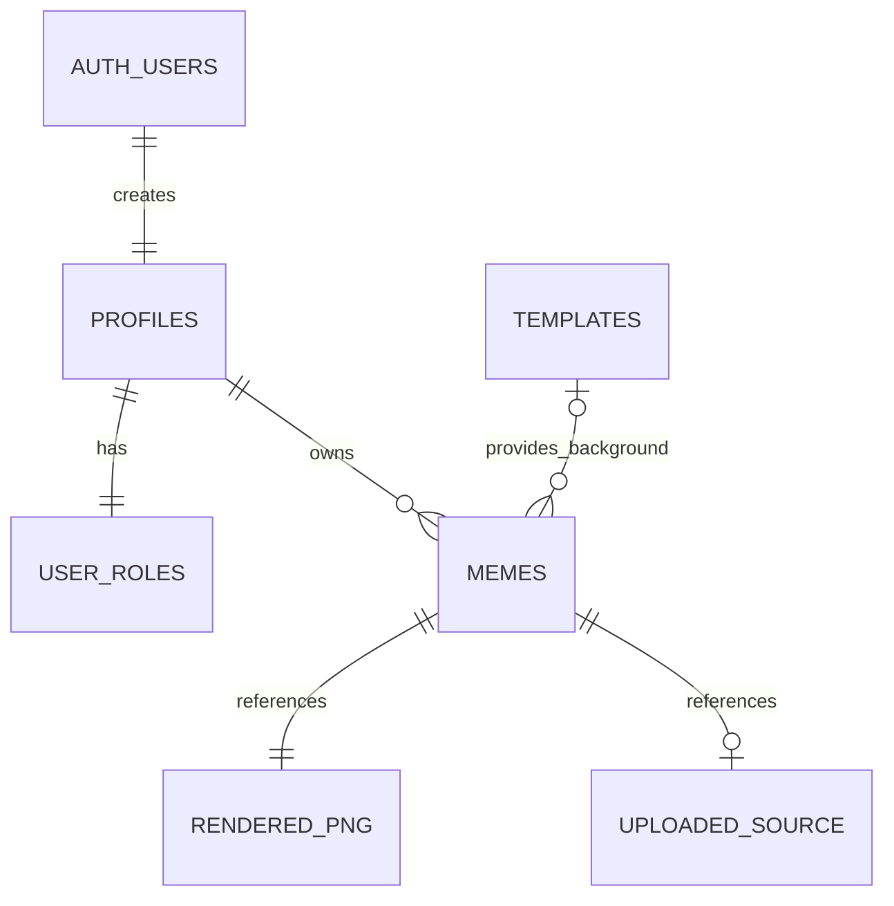

# Meme Lab

Meme Lab е многостранично студио за мемета. Гостът може да използва шаблон или своя снимка, да добави два надписа и да изтегли PNG. Регистрираният потребител може да запазва, редактира, изтрива и публикува мемета. Администраторът управлява видимостта им в галерията.

## Архитектура

HTML, CSS, Bootstrap 5 и JavaScript модули. Vite компилира седем отделни HTML страници. Canvas генерира PNG в браузъра. Supabase JS използва PostgREST за таблици и RPC, Supabase Auth за JWT сесии и Supabase Storage за оригинали и PNG. PostgreSQL прилага RLS, а администраторските действия минават през проверка на ролята в `user_roles`.



Последните две полета сочат към обекти в частния bucket `meme-files`. Оригиналът е достъпен само за собственика. Рендерираният PNG следва правата за четене на записа. Галерията използва подписани адреси с 15-минутна валидност. Вече издаден адрес може да работи до изтичане, след като мемето бъде скрито. При редакция новите файлове се качват преди запис на версията, а старите се почистват след успешна смяна. При прекъсната връзка могат да останат нереферирани файлове за почистване през Storage API.

## Локално стартиране

Изисква Node.js 20.19+ (клон 20) или 22.12+ и npm.

```bash
npm ci
cp .env.example .env.local
npm run dev
```

Без конфигурация работят редакторът, PNG експортът и примерната галерия. За цялото приложение използвай свой Supabase проект или локалния стек през Supabase CLI и Docker.

```bash
npx supabase start
npx supabase status
```

В `.env.local` задай `VITE_SUPABASE_URL` и `VITE_SUPABASE_PUBLISHABLE_KEY` от `status` или от настройките на хоствания проект. Допустим е и legacy anon key. Рестартирай Vite след промяна. Достъп до localhost от друг хост изисква достижим Supabase URL.

## Миграции за хостван проект

```bash
npx supabase login
npx supabase link --project-ref YOUR_PROJECT_REF
npx supabase db push
npx supabase migration list
```

Локалната и отдалечената история трябва да показват едни и същи версии. Ако има миграции, създадени от друг разработчик, синхронизирай ги с `npx supabase migration fetch` и прегледай промените преди следващ `db push`. SQL файловете се проследяват в Git. Командите са за отделен проект за Meme Lab.

## Тестови акаунти

След прилагане на миграциите стартирай `node scripts/create-demo.mjs` със зададени сървърни променливи `SUPABASE_URL` и `SUPABASE_SERVICE_ROLE_KEY`. За администратор задай отделно `ADMIN_EMAIL` и силна `ADMIN_PASSWORD`. Скриптът запазва паролите на съществуващи акаунти. Използвай service role ключа само в доверена локална или сървърна среда.

| Роля | Имейл | Парола |
|---|---|---|
| Демо потребител | demo@example.com | MemeLab2026! |
| Администратор | Стойност от `ADMIN_EMAIL` | Стойност от `ADMIN_PASSWORD` |

Демо акаунтът е споделен и е предназначен за тестови изображения.

## Публикуване

В Netlify импортирай GitHub хранилището и задай двете променливи с префикс `VITE_` преди build. Командата е `npm run build`, а директорията за публикуване е `dist`. В Supabase Auth задай публичния URL като Site URL и добави `https://YOUR_SITE/login.html` към позволените пренасочвания за потвърждение. За публичен проект настрой SMTP и потвърждение по имейл според настройките на Supabase. Изпълни `npm test` и `npm run build` преди публикуване.

## Основни файлове

| Път | Предназначение |
|---|---|
| `*.html` | Начало, редактор, галерия, колекция, вход, регистрация и администратор |
| `src/pages/` | Контролери на страниците |
| `src/ui/`, `src/style.css` | Навигация, карти, съобщения и оформление |
| `src/services/` | Supabase клиент, сесии, CRUD и файлове |
| `src/canvas.js` | Рендериране на надписите, PNG експорт |
| `public/templates/` | Оригинални SVG шаблони |
| `supabase/migrations/` | Схема, индекси, RLS и Storage |
| `scripts/create-demo.mjs` | Създаване на тестови акаунти |
| `.github/copilot-instructions.md` | Инструкции за AI разработка |
